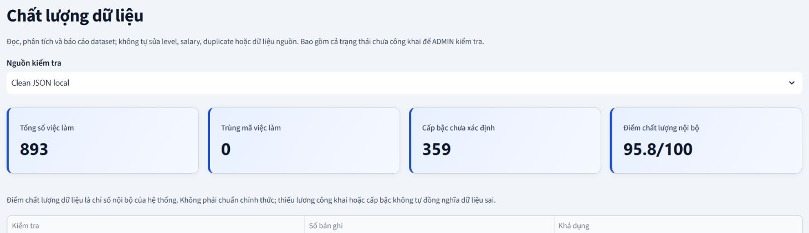
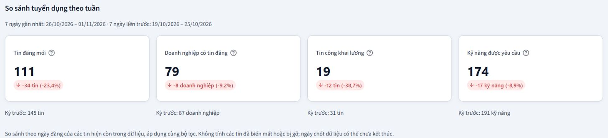

I worked on **AWS & Analytics** for **Vietnam IT Job Market**, covering Amazon S3, AWS Glue Data Catalog, Amazon Athena, SQL, data quality and historical analysis in the prototype.

The 12 worklog entries are organized by topic. Dates refer to records or evidence files. An em dash indicates no confirmed date. November dates refer to project completion and deployment after the internship.

Study periods are estimated from 10 August to 30 October 2026 and progress from fundamentals to specialized topics. Dates in project connections and evidence follow the project records.

### Weekly progress

**Week 1** · [Getting started with AWS and cost management](1.1-Week1/)

**Week 2** · [IAM and access control](1.2-Week2/)

**Week 3** · [VPC and networking](1.3-Week3/)

**Week 4** · [EC2 and scheduled operations](1.4-Week4/)

**Week 5** · [Amazon S3 and data organization](1.5-Week5/)

**Week 6** · [ETL and Parquet](1.6-Week6/)

**Week 7** · [AWS Glue Data Catalog and schemas](1.7-Week7/)

**Week 8** · [Amazon Athena and basic SQL](1.8-Week8/)

**Week 9** · [SQL reconciliation and public data](1.9-Week9/)

**Week 10** · [Data quality checks](1.10-Week10/)

**Week 11** · [Historical analysis, skills and weekly KPIs](1.11-Week11/)

**Week 12** · [AWS review and project verification](1.12-Week12/)

### Project evidence

*Local Data Quality check on 1 November 2026. The sample has 893 postings, zero duplicate job IDs and an internal score of 95.8/100.*

*Comparison of two seven-day periods in the local dataset.*

| Local KPI | 26/10–01/11/2026 | 19/10–25/10/2026 | Change |
| --- | --- | --- | --- |
| New postings | 111 | 145 | −23,4% |
| Companies with postings | 79 | 87 | −9,2% |
| Postings with public salary | 19 | 31 | −38,7% |
| Skills requested | 174 | 191 | −8,9% |
