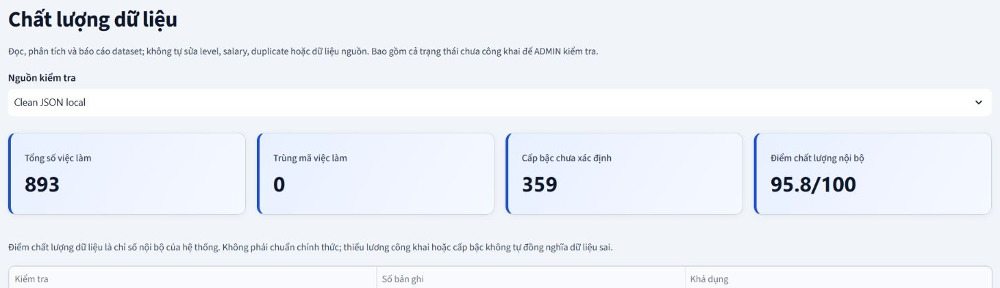
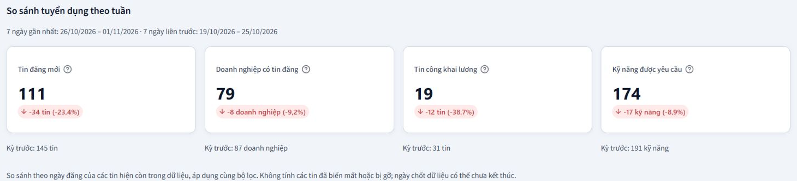

Trong dự án **Vietnam IT Job Market**, em phụ trách **AWS & Analytics**, gồm Amazon S3, AWS Glue Data Catalog, Amazon Athena, các truy vấn SQL, kiểm tra chất lượng dữ liệu và phân tích lịch sử trong giai đoạn thử nghiệm.

Nhật ký gồm 12 mục theo chủ đề công việc. Cột Ngày ghi mốc có trong hồ sơ hoặc tệp minh chứng. Dấu “—” biểu thị chưa có ngày đối chiếu. Các mốc tháng 11 thuộc hồ sơ hoàn thiện và triển khai dự án sau kỳ thực tập.

### Tiến độ theo tuần

**Tuần 1** · [Phạm vi dữ liệu và vai trò trong nhóm](1.1-Week1/)

**Tuần 2** · [Từ dữ liệu thu thập đến dữ liệu hiện tại](1.2-Week2/)

**Tuần 3** · [Parquet và tổ chức dữ liệu trên Amazon S3](1.3-Week3/)

**Tuần 4** · [AWS Glue Data Catalog và Amazon Athena](1.4-Week4/)

**Tuần 5** · [SQL cho dữ liệu công khai](1.5-Week5/)

**Tuần 6** · [Truy vấn và bộ lọc của dashboard](1.6-Week6/)

**Tuần 7** · [Đối soát lần xuất bản trên EC2](1.7-Week7/)

**Tuần 8** · [Kiểm tra chất lượng dữ liệu](1.8-Week8/)

**Tuần 9** · [Phân tích lịch sử và kỹ năng trên bản thử nghiệm](1.9-Week9/)

**Tuần 10** · [KPI so sánh theo tuần](1.10-Week10/)

**Tuần 11** · [Đối chiếu phạm vi bàn giao](1.11-Week11/)

**Tuần 12** · [Nghiệm thu triển khai và tổng kết](1.12-Week12/)

### Minh chứng dự án

*Kiểm tra Data Quality trên clean JSON local ngày 01/11/2026. Mẫu có 893 tin, 0 mã việc làm trùng và điểm chất lượng nội bộ 95,8/100.*

*So sánh KPI của hai kỳ bảy ngày trên dữ liệu local.*

| KPI local | 26/10–01/11/2026 | 19/10–25/10/2026 | Thay đổi |
| --- | --- | --- | --- |
| Tin đăng mới | 111 | 145 | −23,4% |
| Doanh nghiệp có tin đăng | 79 | 87 | −9,2% |
| Tin công khai lương | 19 | 31 | −38,7% |
| Kỹ năng được yêu cầu | 174 | 191 | −8,9% |
