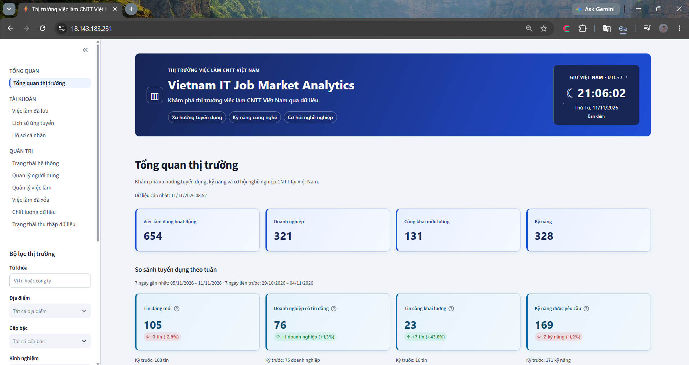

The application provides **Guest**, **User** and **Administrator** access. Guests can view the market overview; users have personal features; administrators can access user management, job moderation and system monitoring. Accounts and personal activity are stored on Amazon S3.

---

[← 5.10. Account and Administration Setup](../) · [Workshop contents](../../) · [Next step →](../5.10.2-step2/)
