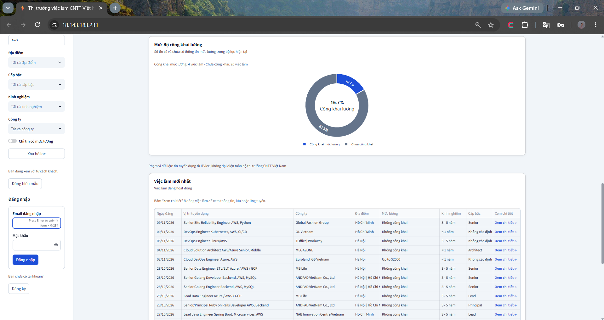
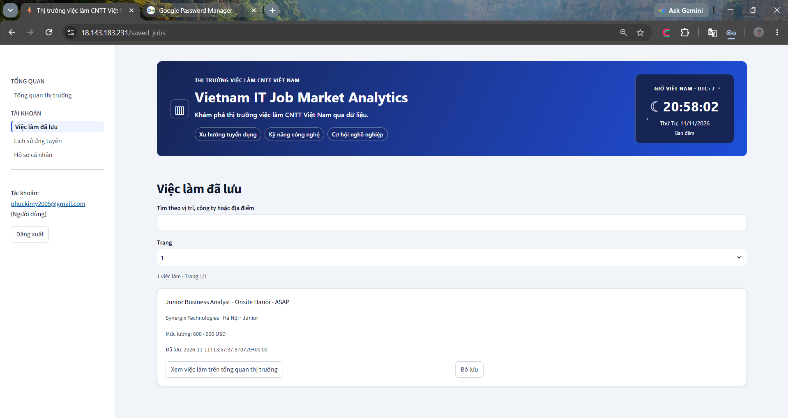
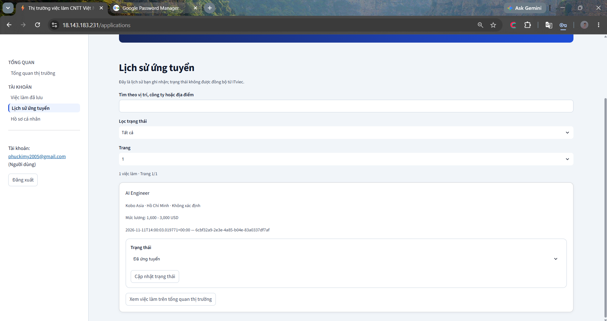

The application supports registration and login using an email address and password. After logging in, users can save jobs of interest, track applications and manage their personal profiles.

**Saved jobs** brings together listings to revisit and supports searching, opening listings and removing saved jobs.

**Application history** helps users track their job search progress. Users update the status themselves; it is not automatically synchronized from ITviec.

---

[← 5.10. Account and Administration Setup](../) · [Workshop contents](../../) · [Previous step](../5.10.1-step1/) · [Next step →](../5.10.3-step3/)
