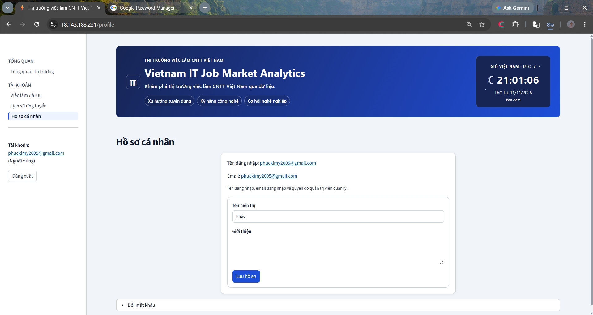
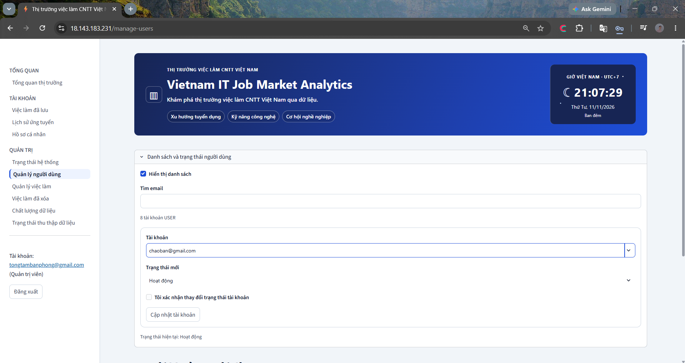
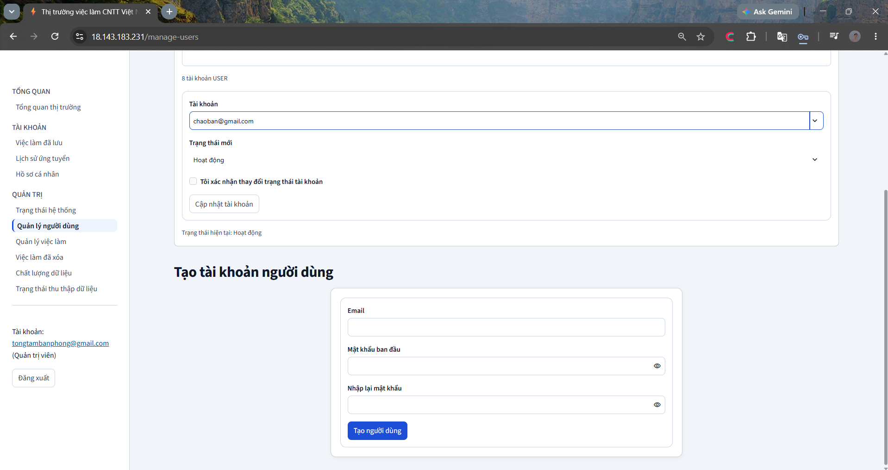

The **Personal profile** page allows users to update their display name and introduction, and change their password.

The **User management** page helps ADMIN find accounts and manage their active status. ADMIN can also create USER accounts using an email address and an initial password.

---

[← 5.10. Account and Administration Setup](../) · [Workshop contents](../../) · [Previous step](../5.10.2-step2/)
