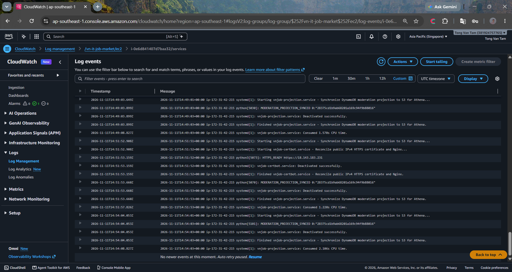
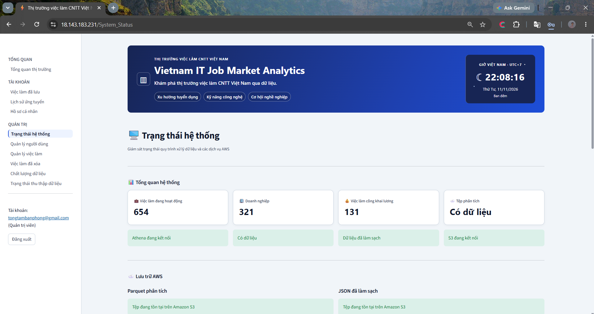
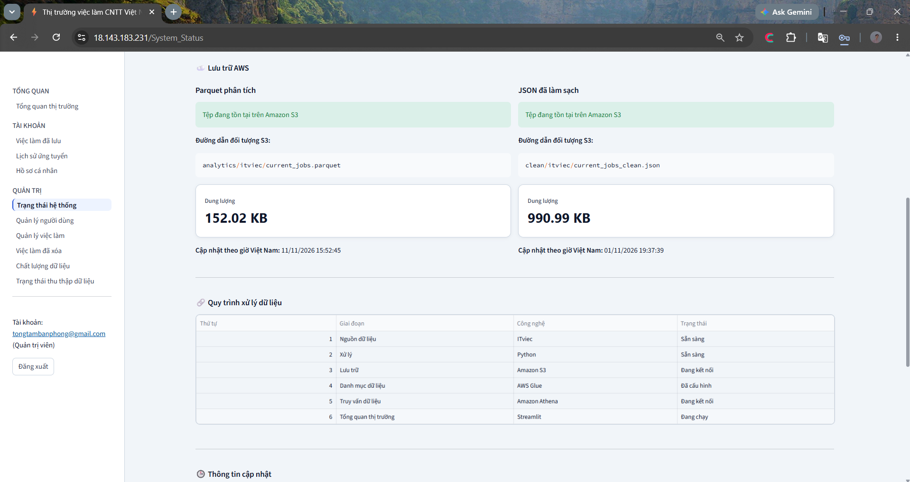
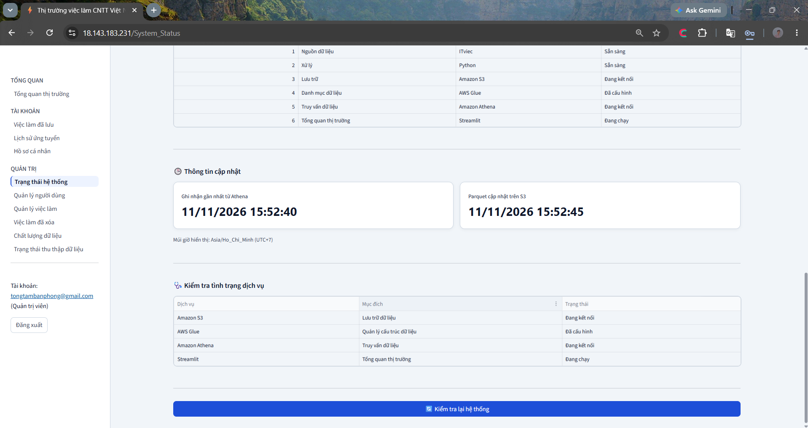
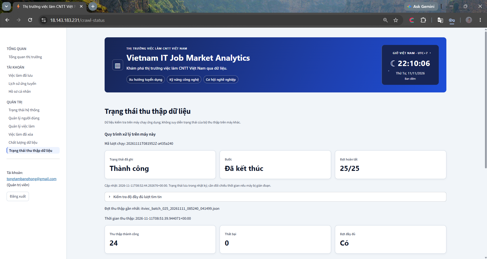
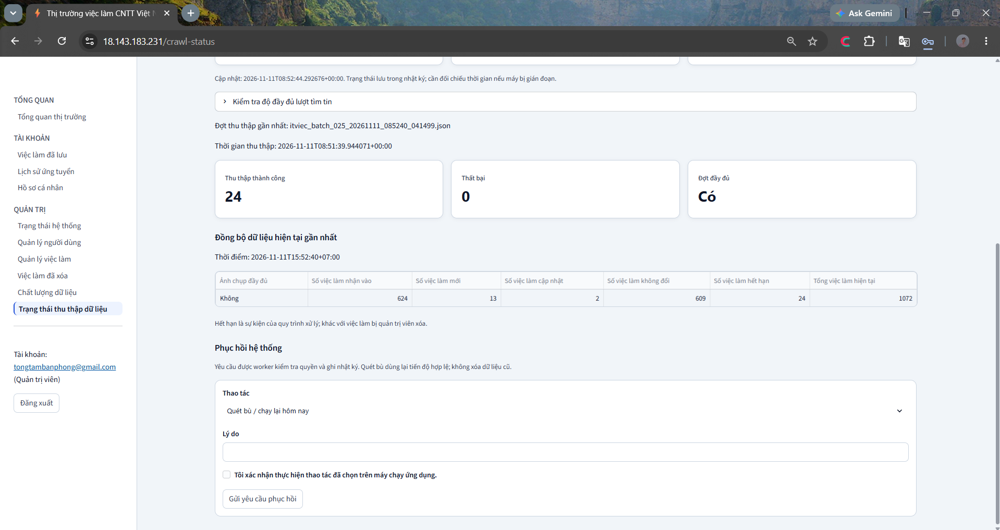
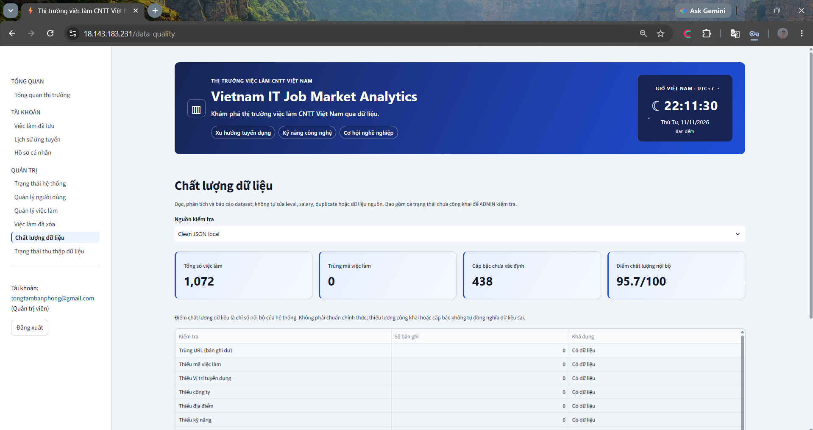
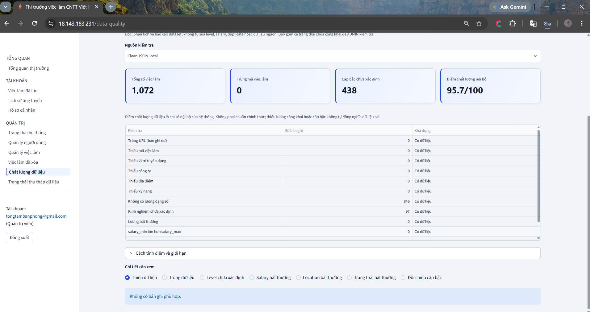

**Performed in:** CloudWatch, the ADMIN website and SSM

### Objective

Use the administrative pages and runbook after setup.

### Prerequisites

Logs/artifacts and ADMIN access are available.

### Procedure

Open System status, Data collection status and Data quality. Compare the run_id, timestamps, stage, row counts and warnings against artifacts/queries from the same run. Salary information missing because the source does not disclose it differs from a missing required field error.

~~~bash
sudo systemctl status vnjob-dashboard vnjob-pipeline vnjob-pipeline.timer --no-pager
sudo journalctl -u vnjob-pipeline.service -n 120 --no-pager
df -h /opt/vn-it-job-market
free -m
~~~

When an incident occurs, inspect the logs to identify the failed step and check network connectivity, access permissions or input data. Compare CloudWatch logs with the run status on EC2 before taking action.

### Monitoring logs in CloudWatch

Open log group **/vn-it-job-market/ec2** and select stream **i-0e6d841407d7baa32/services** to view events over time. The logs help monitor services and investigate the cause of incidents.

The screenshot records **MODERATION_PROJECTION_SYNCED** from the Projection Worker and **HTTPS_READY https://18.143.183.231** from the HTTPS management service. The **Deactivated successfully** and **Finished** lines record service runs that completed successfully.

### Monitoring system status on the website

Log in with an administrator account and select **System status**. This page brings together data connection status, stored files and update timestamps so administrators can monitor application operations.

**System overview** shows 654 active jobs, 321 employers and 131 jobs with disclosed salaries. The page reports that Athena and S3 are connected and that analytical data and cleaned data are available.

**AWS storage and data processing** helps check file locations and the components involved in processing. The screenshot shows the analytical Parquet file on S3 with a size of 152.02 KB, updated on 11/11/2026; the cleaned JSON file on S3 has a separate update date of 01/11/2026.

**Update information and service status** helps monitor data freshness. The page shows the latest observation from Athena at 15:52:40 and the Parquet update on S3 at 15:52:45 on 11/11/2026, Vietnam time; the service table shows the status of S3, Glue, Athena and Streamlit.

### Monitoring data collection status

Select **Data collection status** to monitor pipeline progress and synchronization results. Run **20261111T081952Z-a435a240** shows **Successful**, **Finished** and completion of **25/25 batches**. The final batch successfully collected **24 listings**, with no failed listings, and was recorded as complete.

The synchronization table records **624 incoming jobs**, comprising **13 new jobs**, **2 updates** and **609 unchanged jobs**; current data totals **1,072 jobs**. The table also records **24 expired jobs** and a complete snapshot status of **No**. The **System recovery** form allows administrators to submit a catch-up scan or rerun-today request, with a reason and confirmation.

### Monitoring data quality

Select **Data quality** and use the **Clean JSON local** source to view checks on the cleaned dataset on EC2. This page helps administrators detect duplicate records, missing fields and unusual values; it does not automatically correct source data.

The screenshot shows **1,072 jobs**, **0 duplicate job IDs**, **438 jobs with an unknown level** and an internal quality score of **95.7/100**.

The checks record **0 duplicate URLs** and no missing job IDs, job titles, companies, locations or skills. There are **846 records without numeric salary information** and **97 records with unknown experience**; both unusual salary records and records where salary_min exceeds salary_max have a count of **0**. The detail groups help administrators inspect records requiring review. Missing salary or level information does not automatically mean the data is incorrect; the quality score is an internal metric.

---

[← 5.13. CloudWatch and Monitoring Setup](../) · [Workshop contents](../../) · [Previous step](../5.13.2-step2/)
