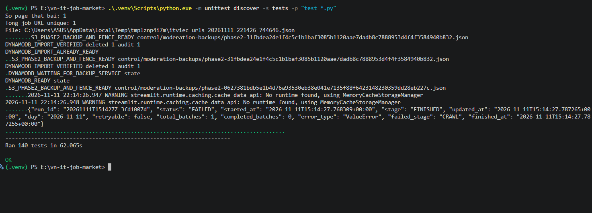
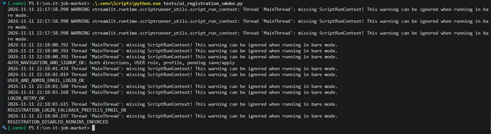
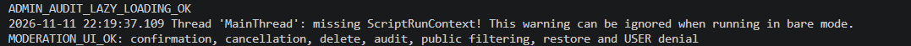
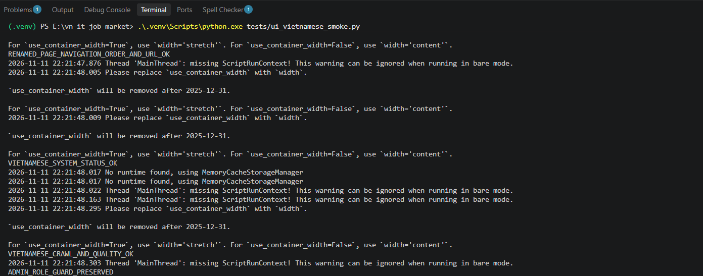

Testing on the development machine helps check processing logic and interface flows before release. On **11/11/2026**, the tests performed produced the following results:

| Item | Result |
| --- | --- |
| Unit tests | 140 tests, completed in 62.065 seconds; OK |
| Registration and login | Authentication checks passed |
| Job moderation | Confirm/cancel, soft deletion, restoration, audit logs and USER permission restrictions passed in the tests |
| Vietnamese interface | Navigation, monitoring pages and ADMIN permission restrictions passed |

**Unit test results**

**Registration and login**

**Job moderation**

**Vietnamese interface**

---

[← 5.14. Testing and Deployment Acceptance](../) · [Workshop contents](../../) · [Next step →](../5.14.2-step2/)
